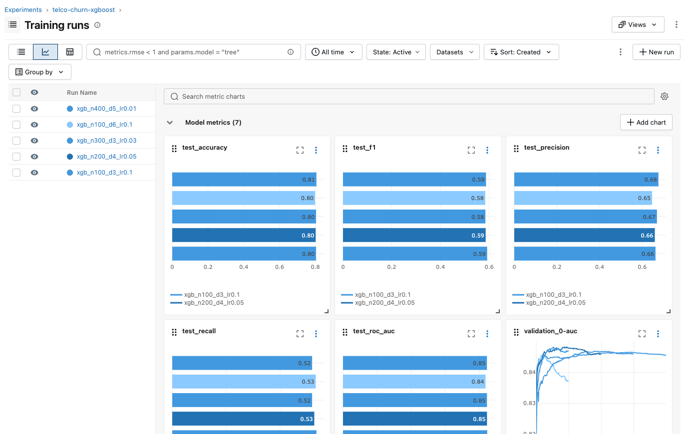
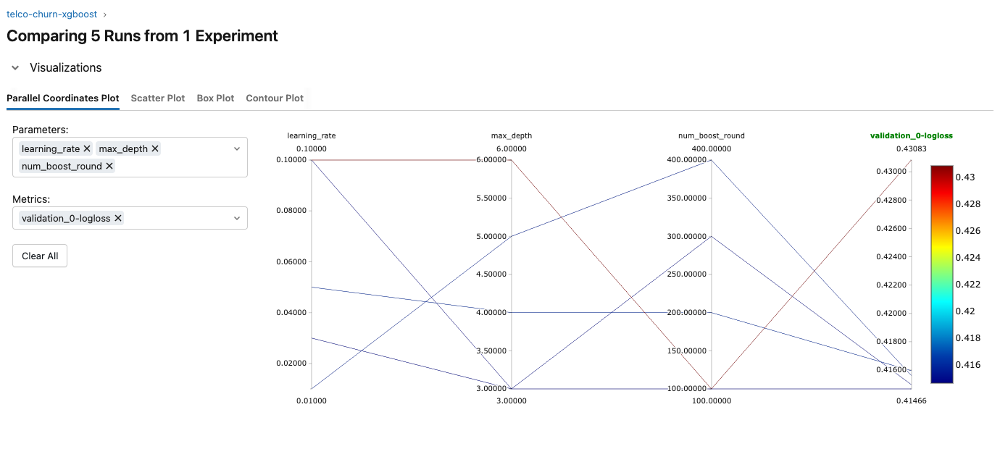
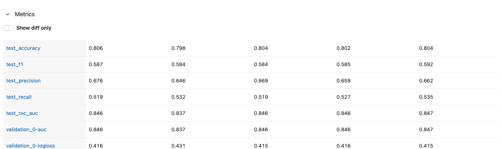
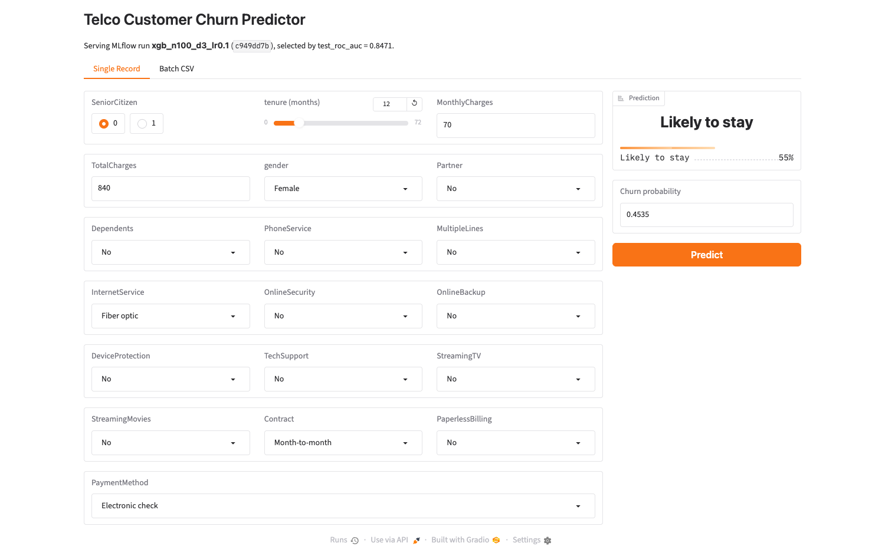
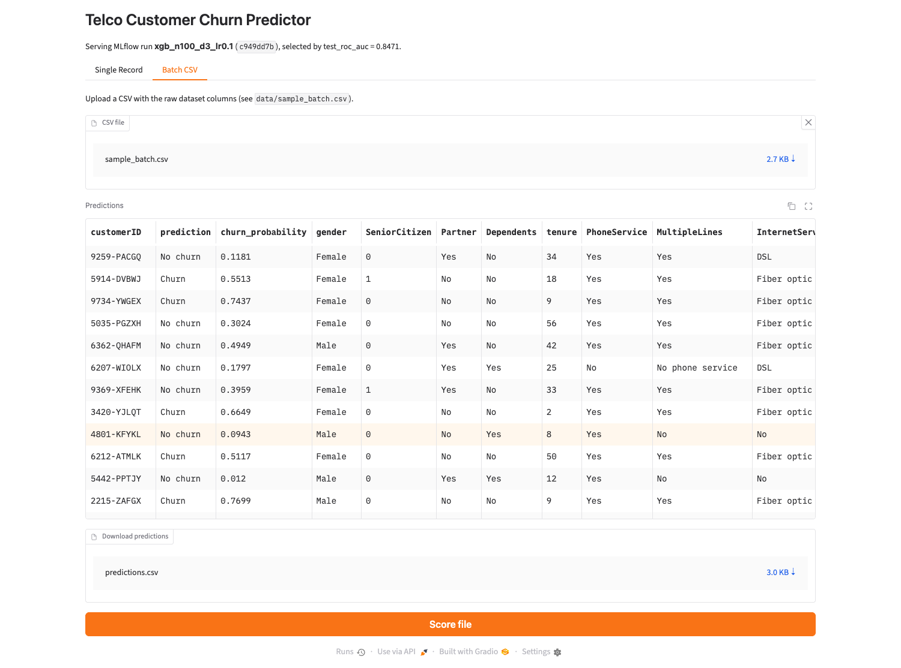

# Telco Customer Churn: MLflow Experiment Tracking & Gradio Deployment

An end-to-end ML pipeline that trains an XGBoost classifier to predict customer churn, tracks every experiment with **MLflow autologging**, selects the best run automatically, and serves it through a **Gradio** web app with single-record and batch CSV prediction.

## Dataset

[IBM Telco Customer Churn](https://www.kaggle.com/datasets/blastchar/telco-customer-churn): 7,043 customers, 19 features (demographics, account info, subscribed services), binary target `Churn` (26.5% positive).

Preprocessing (`src/data.py`):
- `TotalCharges` is stored as text and is blank for zero-tenure customers, so it's coerced to numeric and the gaps are filled with 0
- 15 categorical columns are one-hot encoded with Pandas
- Stratified 80/20 train/test split with scikit-learn

## Pipeline

```
data/telco_churn.csv
        │
        ▼
src/data.py        clean → one-hot encode → stratified split
        │
        ▼
src/train.py       mlflow.xgboost.autolog() + 5-run hyperparameter sweep
        │          (params, per-iteration logloss/AUC, model artifact, dataset all autologged)
        ▼
src/best_model.py  mlflow.search_runs() ordered by test_roc_auc → mlflow.xgboost.load_model()
        │
        ▼
src/app.py         Gradio app: Single Record tab + Batch CSV tab
```

## Experiment results

Five runs varying `n_estimators`, `max_depth` and `learning_rate`, evaluated on the held-out test set:

| Run | n_estimators | max_depth | learning_rate | Accuracy | F1 | ROC AUC |
|---|---|---|---|---|---|---|
| **xgb_n100_d3_lr0.1** | 100 | 3 | 0.10 | 0.804 | **0.592** | **0.847** |
| xgb_n200_d4_lr0.05 | 200 | 4 | 0.05 | 0.802 | 0.585 | 0.846 |
| xgb_n300_d3_lr0.03 | 300 | 3 | 0.03 | 0.804 | 0.584 | 0.846 |
| xgb_n100_d6_lr0.1 | 100 | 6 | 0.10 | 0.798 | 0.584 | 0.837 |
| xgb_n400_d5_lr0.01 | 400 | 5 | 0.01 | 0.806 | 0.587 | 0.846 |

The shallow `max_depth=3` model generalised best; the deepest tree (`max_depth=6`) overfit and had the worst validation logloss.

### MLflow UI: metric charts across runs



### MLflow UI: run comparison





## Gradio app

The app loads the best run's model straight from the MLflow tracking store, so retraining and relaunching always serves the current best model.

**Single Record:** enter a customer's details and get a churn probability.



**Batch CSV:** upload a CSV of customers (same columns as the raw dataset) and download the scored file.



## Run it locally

```bash
git clone https://github.com/Subzero-005/telco-churn-mlflow.git
cd telco-churn-mlflow
python3.11 -m venv .venv && source .venv/bin/activate
pip install -r requirements.txt

# 1. Train and track the 5 experiment runs
python src/train.py

# 2. Browse the runs in the MLflow UI → http://localhost:5000
mlflow ui --backend-store-uri sqlite:///mlflow.db

# 3. Print the best run
python src/best_model.py

# 4. Launch the app → http://localhost:7860
cd src && python app.py
```

Try the Batch CSV tab with `data/sample_batch.csv`.

## Project structure

```
├── data/
│   ├── telco_churn.csv      # raw dataset
│   └── sample_batch.csv     # 20 unlabeled rows for the batch tab
├── images/                  # README screenshots
├── src/
│   ├── config.py            # tracking URI, experiment name, selection metric
│   ├── data.py              # loading, cleaning, encoding, split
│   ├── train.py             # MLflow-autologged hyperparameter sweep
│   ├── best_model.py        # best-run lookup and model loading
│   └── app.py               # Gradio app
└── requirements.txt
```

## Tech stack

Python · Pandas · scikit-learn · XGBoost · MLflow · Gradio
